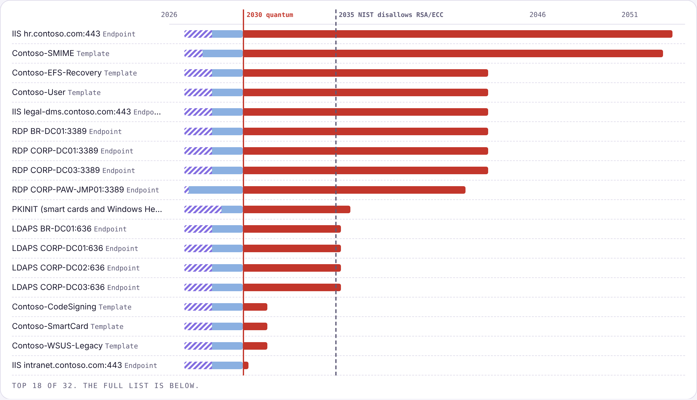

# Quantum-Ready Windows PKI

**Find the cryptography in your Windows estate that a quantum computer could break, and fix it in the right order.** The tool inventories AD CS certification authorities and templates, TLS on LDAPS, RDP, IIS and WSUS, and Kerberos encryption types and PKINIT. It ranks each finding by how long the data it protects has to stay secret, then builds a five-phase migration roadmap based on what Windows can actually do today.

[**View the sample report**](https://aayyagar.github.io/quantum-ready-pki/sample-report/) · PowerShell 7 · MIT license · v1.0.0

```text
PS> .\Invoke-QuantumReadyPki.ps1 -Demo

  14 systems protect data that must stay secret past 2030  ·  22 migrations overdue  ·  18 broken today
  32 of 45 assets quantum-vulnerable  ·  hybrid ML-KEM on 2, available but off on 1
```



---

## Why this exists

A cryptographically relevant quantum computer breaks RSA, elliptic-curve and Diffie-Hellman cryptography. Two things follow:

- **Harvest now, decrypt later.** Traffic and files recorded today can be read once that computer exists. If HR data must stay private for 25 years, it's already too late for RSA and ECDHE.
- **Forgery later.** Any CA whose public key is still trusted then can be impersonated.

General quantum-readiness scanners (for example [quantumshield-pqc](https://pypi.org/project/quantumshield-pqc/)) look at source code and network traffic. Most Windows estates keep their keys somewhere else: in AD CS, certificate templates, Schannel and the KDC. Windows has also gained real post-quantum features in the last year, each with its own limits. This tool is built for that estate:

| Windows / AD CS today | What it means for you |
|---|---|
| ML-KEM and ML-DSA in CNG (Windows 11, Server 2025, Nov 2025) | Only CNG Key Storage Providers can use them; templates on legacy CryptoAPI providers can't |
| ML-DSA CAs in AD CS (Server 2025, KB5087539, May 2026) | New CA only, no in-place migration, signature-only, no NDES |
| Hybrid ML-KEM for TLS 1.3 in Schannel (July 2026 update) | Off by default; Server 2022 and older can't do it |
| Kerberos AES-only by default (CVE-2026-20833, April 2026; rollback removed July 2026) | RC4-only accounts and trusts now fail |
| No post-quantum S/MIME, EFS or PKINIT | Encryption certificates and smart-card logon stay classical for now |

## How the ranking works

Each quantum-vulnerable asset gets a **start-by date** from Mosca's inequality (Michele Mosca, 2015): if *shelf life* + *migration time* > *years until a quantum computer*, the data is already at risk.

- **Confidentiality** (key exchange and encryption: TLS endpoints, S/MIME and EFS templates, PKINIT) is dated by **start by = quantum year − migration − shelf life**.
- **Authenticity** (CA keys, signing templates, server certificates) is dated by **start by = quantum year − migration − validity** of the certificates that will still be issued.

Shelf life comes from a classification on each asset, with defaults per service. Pass your own with `-ShelfLife`:

| Classification | Years | Default for |
|---|---|---|
| Public | 0 | — |
| Internal | 2 | IIS, WSUS |
| Confidential | 7 | LDAPS, RDP, PKINIT |
| Restricted | 15 | S/MIME and EFS templates |
| Regulated | 25 | — |

Migration-time estimates (override with `-MigrationYears`): a new CA hierarchy 3 years, a template 1 year (+0.5 on a legacy provider), an OS upgrade 1.5 years, a TLS setting 0.25 years, reissuing certificates 1 year, PKINIT 2 years.

The quantum year defaults to **2030**, when NIST's transition timeline (IR 8547) deprecates 112-bit RSA and ECC. Use `-QuantumYear 2035`, when they're disallowed, for a less conservative plan. Microsoft aims to finish its own transition by 2033.

## What it checks

| Code | Area | Finding |
|---|---|---|
| QR-01 / 02 | CA, template, certificate | SHA-1 signatures; RSA keys below 2048 |
| QR-03 | CA | RSA 2048 trusted past 2030 |
| QR-04 | CA | Classical CA trusted after the quantum year: build the ML-DSA hierarchy |
| QR-06 | Template | Schema v1/v2 or legacy CSP: can't become ML-DSA |
| QR-07 | Template | Encryption certificates (S/MIME, EFS, recovery) with no post-quantum path; archived keys |
| QR-09 | Template | Validity that runs into the quantum year |
| QR-10 / 11 | Endpoint | RSA key transport (no forward secrecy); TLS 1.0/1.1 |
| QR-12 | Endpoint | Windows release can't do hybrid ML-KEM: upgrade to Server 2025 |
| QR-13 | Endpoint | Hybrid ML-KEM available but off: the quick win |
| QR-15 / 16 / 27 | Endpoint | Self-signed RDP/LDAPS certificate; WSUS over HTTP; expired certificate |
| QR-17 / 18 / 19 | Kerberos | RC4 enabled; no AES keys (password older than AES); DES |
| QR-20 / 21 / 23 | Kerberos | RC4 in `DefaultDomainSupportedEncTypes`; RC4-only trusts; old krbtgt |
| QR-22 | Kerberos | PKINIT (smart cards, Windows Hello) relies on classical public keys |
| QR-24 / 25 / 26 | Several | Classical server certificate; unsupported OS; classical root left in trust stores |

## The roadmap

| Phase | Name | What goes in it |
|---|---|---|
| 0 | Fix what is broken today | SHA-1, RSA 1024, RC4, DES, TLS 1.0/1.1, RSA key transport, WSUS over HTTP |
| 1 | Make the estate crypto-agile | CNG/KSP schema v3+ templates; TLS hosts on Windows Server 2025 |
| 2 | Stop harvest-now, decrypt-later | Turn on hybrid ML-KEM, most sensitive data first; reduce encryption-certificate exposure |
| 3 | Build the post-quantum PKI | A parallel ML-DSA hierarchy, pilot templates, reissue as clients allow |
| 4 | Retire classical trust before 2035 | Remove classical roots from NTAuth, GPO and Intune trust stores |

## What you get

| Output | Contents |
|---|---|
| `index.html` | Headline exposure, Mosca chart, ranked inventory with findings and the Windows path for each asset, fix-first list, capability matrix, roadmap, Kerberos |
| `cbom.cdx.json` | A [CycloneDX 1.6](https://cyclonedx.org/capabilities/cbom/) cryptography bill of materials: certificates, protocols, key material and algorithms with NIST quantum security levels |
| `inventory.csv` | One row per asset with rank, crypto, classification, shelf life, start-by date and findings |
| `roadmap.md` | The ranked list and five phases, for a change board |
| `findings.json` | Everything, for your own tooling |

## Quick start

```powershell
git clone https://github.com/aayyagar/quantum-ready-pki.git
cd quantum-ready-pki
.\Invoke-QuantumReadyPki.ps1 -Demo
```

The demo is a fictional Contoso estate: four CAs (including an ML-DSA pilot), 14 templates, 17 endpoints and 63 Kerberos service accounts.

### On your estate

Run it from a domain-joined Windows machine as any domain user. No admin rights are needed.

```powershell
.\Invoke-QuantumReadyPki.ps1 `
    -Endpoints 'hr.contoso.com:443:IIS:Regulated', 'wsus01.contoso.com:8531:WSUS', 'legal.contoso.com:443:IIS:Restricted' `
    -ShelfLife @{ Regulated = 30 } -QuantumYear 2032
```

The tool reads AD CS objects from the configuration partition, finds domain controllers and probes their LDAPS and RDP ports, then probes the endpoints you list (`host:port[:service][:classification]`). It also reads Kerberos settings from the domain. Everything is LDAP reads and TLS handshakes.

| Parameter | Default | Purpose |
|---|---|---|
| `-Demo` | | Assess the bundled demo estate |
| `-InputPath` | | Assess an offline snapshot (demo format), e.g. one built by your CMDB export |
| `-QuantumYear` | 2030 | Planning year for a cryptographically relevant quantum computer |
| `-ShelfLife` | see above | Classification → years |
| `-MigrationYears` | see above | Override migration-time estimates |
| `-Endpoints` | | Extra IIS/WSUS/other endpoints to probe |
| `-OutputPath` | `.\QuantumReadiness_<timestamp>` | Report folder |

## Good to know

- **Key exchange in live mode.** .NET doesn't expose the TLS group, so live probes can't confirm hybrid ML-KEM by themselves. For Server 2025 hosts, put `keyExchange` in a snapshot (`-InputPath`) once you've confirmed it with a client capture, or check the host's Schannel configuration.
- **KDC events** 201–209 come from the System logs on your DCs. Add the counts to a snapshot, or forward them to your SIEM and join them there. The live collector doesn't read remote event logs.
- **`aesKeysSince`**: accounts whose password was last set before the domain had AES keys can't get AES tickets. Live mode assumes 2008; set the real date in a snapshot if your domain was raised later.
- **Kerberos itself** uses AES, which quantum computers don't break in any practical way. It appears here because RC4 and DES are broken today and because PKINIT is classical public-key cryptography.
- **Classification is yours to decide.** The defaults are a starting point. A Regulated label on the right IIS site changes the ranking more than any other input.

## Project layout

```text
Invoke-QuantumReadyPki.ps1   the tool (single file, dot-sourceable)
report/template.html         report template
demo/sample-estate.json      fictional Contoso estate
tools/make-demo.py           regenerates the demo
tests/                       Pester 5 tests
sample-report/               the published sample
```

Run the tests with `Invoke-Pester ./tests`.

## References

- Microsoft Learn: [ML-DSA in Active Directory Certificate Services](https://learn.microsoft.com/windows-server/identity/ad-cs/ml-dsa-overview)
- Microsoft: [Windows, TLS 1.3 and post-quantum crypto FAQ](https://techcommunity.microsoft.com/t5/post-quantum-crypto-tech-blog/windows-tls-1-3-and-post-quantum-crypto-faq/ba-p/4556389)
- Microsoft Support: [Managing Kerberos KDC usage of RC4 (CVE-2026-20833)](https://support.microsoft.com/en-us/kb/5073381)
- NIST IR 8547: Transition to Post-Quantum Cryptography Standards
- CycloneDX: [Cryptography Bill of Materials](https://cyclonedx.org/capabilities/cbom/)

## License

MIT © 2026 Akhilesh Ayyagari
